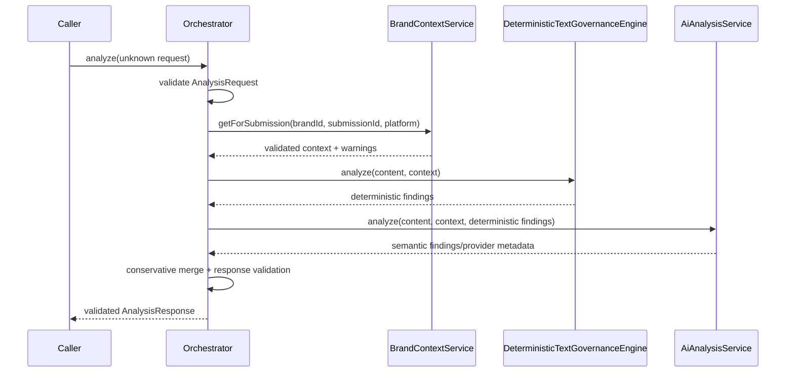

# Unified analysis orchestration

The [`lib/analysis`](../lib/analysis) module is the integration layer for the
Phase 2, 3, and 4 services. It does not duplicate brand retrieval, deterministic
matching, or provider integration logic.

## Architecture and execution sequence

`AnalysisOrchestrator` receives all services through constructor injection.
Tests can therefore use fakes without Supabase, OpenRouter, Gemini, or network
access. Optional run-ID and clock functions are injected for deterministic
tests; production defaults use a UUID when available and the current time.

## Finding combination

Deterministic findings are added first and therefore win when the same issue is
reported by both engines. An AI finding is considered a duplicate only when its
category and normalized issue match and it shares either the same reliable
location or the same evidence source/version/excerpt signature. Findings with
similar wording but different evidence or occurrences remain separate.

All findings retain their original evidence references, version IDs, locations,
provider names, and other contract fields. The final array is validated by
`AnalysisResponseSchema`.

## Errors and partial analysis

Invalid requests produce `InvalidAnalysisRequestError`. Brand retrieval,
deterministic, and AI failures produce `AnalysisOrchestrationError` with a
safe stage identifier and the original typed error in `cause`. AI failure is
never converted to an apparently clean response.

The Phase 1 response contract has no warnings field. When the retrieval service
returns a valid context with warnings for missing approved sections, the
orchestrator returns `analysisStatus: "PARTIAL"` so incomplete knowledge is
distinguished from a complete analysis. The warnings are not fabricated into
findings or response fields.

Final response validation failures are reported through
`AnalysisResponseValidationError`. No shared Phase 1 contract is changed.

## Future API usage

An API route can construct the orchestrator with a real
`BrandContextService`, `DeterministicTextGovernanceEngine`, and
`createAiAnalysisServiceFromEnvironment()`, then pass the untrusted request body
to `analyze`. The route should map typed orchestration errors to its HTTP error
contract and must not expose provider credentials or internal causes.

This phase does not create an API route, persistence adapter, visual analysis
integration, or retry policy.
